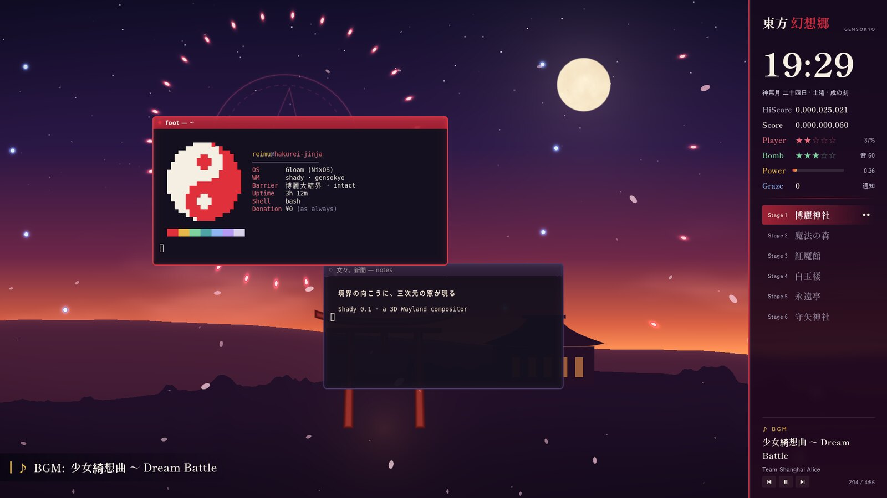
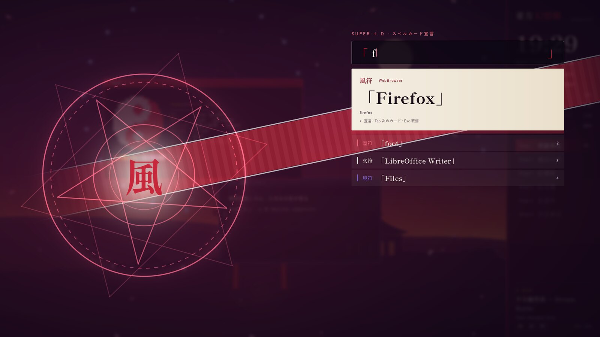
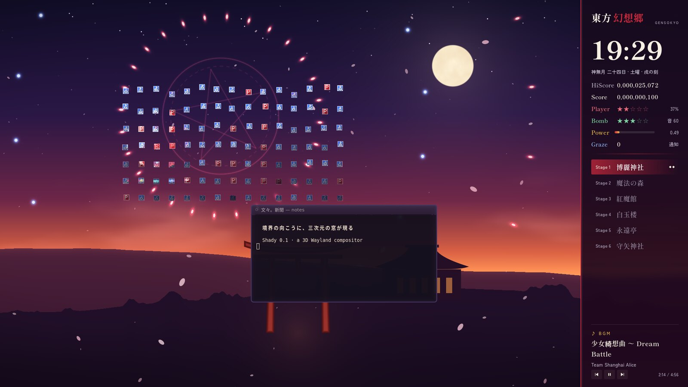
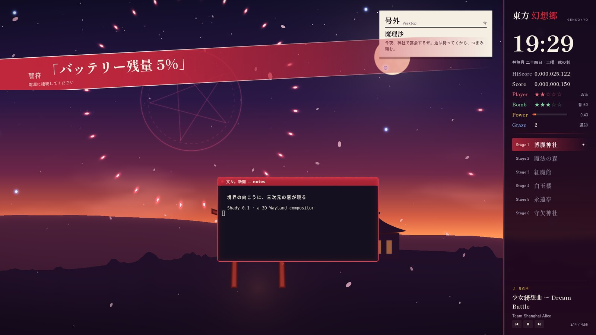
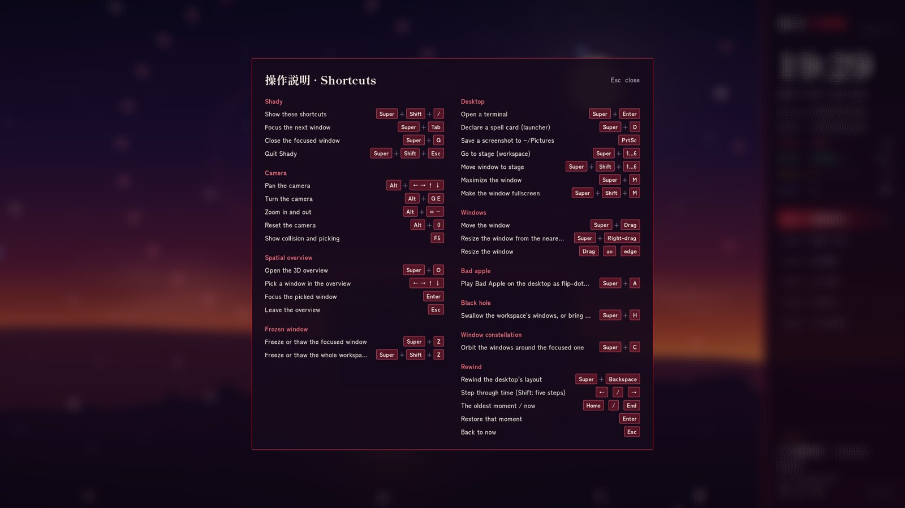

# Gensokyo



*An unofficial Touhou Project fan rice for [Shady](https://github.com/gloaming-dusk/shady).*
The desktop is Gensokyo at dusk: the sky over the Hakurei Shrine goes from
indigo to sunset, a boss pattern turns slowly in it, cherry petals drift
down, and on the right runs the side panel of a Touhou game.

> This is a fan work and not part of the Shady project. Touhou Project is
> the work of ZUN / Team Shanghai Alice; this rice follows their guidelines
> for fan works and is non-commercial. It ships no artwork, sprites or music
> from the games. See [ASSETS-LICENSE.md](ASSETS-LICENSE.md).

## What's in Gensokyo

- **The sky** (`shaders/gensokyo.frag`): drawn entirely by a shader. Dusk
  over the shrine and its torii, a moon, clouds lit from below, rings of
  rice and round bullets leaving a magic circle, and petals. The pattern
  turns faster while music plays.
- **The side panel**, like the one beside a Touhou playfield: the time with
  the old month and double-hour names (神無月 二十四日 · 土曜 · 逢魔時),
  HiScore (uptime) and Score (this session), Player (battery), Bomb
  (volume), Power (CPU), Graze (notifications) and Point (Wi-Fi). Windows
  keep clear of it. Click the title for the spell cards.
- **Stages**: the workspaces are Stage 1 to 6, 博麗神社, 魔法の森, 紅魔館,
  白玉楼, 永遠亭 and 守矢神社, with a mark for each window on them.
- **Spell cards** (`Super+D`): the launcher declares the application as a
  spell card, with a sign that follows its `.desktop` categories, 風符
  for browsers, 霊符 for terminals, 秘術 for editors, 彩符 for graphics
  and so on, over a turning magic circle.
- **Notifications** arrive as 号外, extra editions of the Bunbunmaru
  Newspaper. Critical ones cut in across the screen like a spell card.
- **BGM**: when a new song starts (`playerctl`), it is announced at the
  bottom left the way a stage announces its music, and the panel shows it
  with controls.
- **Point items** (`plugins/point_items.c`): a window you close breaks into
  tiles that turn into blue point items and red power items and are
  collected upward.
- **Bad Apple!!** (`Super+A`): Shady's flip-dot player over the desktop.
- Windows have a red and white frame when focused and a violet one
  otherwise. The shortcut overlay (`Super+Shift+/`) matches the panel.

| | |
|---|---|
|  |  |
|  |  |

## Try it

You need a Shady checkout built with `./tools/build.sh`, recent enough for
side panels, application categories and `u_uv_rect` in plugin shaders.
From your Wayland desktop:

```sh
git clone https://github.com/gloaming-dusk/shady-rice-touhou
SHADY_ROOT=~/path/to/shady ./shady-rice-touhou/run.sh
```

Or directly on a VT (DRM + libinput), from a TTY login:

```sh
SHADY_ROOT=~/path/to/shady ./shady-rice-touhou/run-native.sh
```

Both build the point-item plugin (`build.sh`) the first time; it needs a C
compiler and Shady's headers, which the Shady checkout has.

## Use it as your session

```sh
./build.sh               # the point-item plugin, into build/
./install.sh             # links the rice into ~/.config/shady
./install.sh --uninstall # removes the links again
```

`shady-session` uses your `~/.config/shady/*.lua` files in place of the
built-in rice. The script will not overwrite files you already have there.

## Extras

- **A picture of your own in the panel**: `tools/portrait.sh picture.jpg`
  crops it into the card above the clock (`--remove` takes it out). It is
  kept in `~/.local/share/shady/touhou/`, never in this repository.
- **Bad Apple!!** needs frames made from your own copy of the video, with
  Shady's `tools/bad-apple.sh video.mp4`.
- **The yin-yang orb in your terminal**: `tools/fetch.sh`.
- **Terminal colours**: `extras/foot.ini`, to include from your foot
  config.

## Keys

| Keys | |
|---|---|
| `Super+Return` | terminal |
| `Super+D` | spell cards (launcher) |
| `Super+1…6` | Stage 1 … 6 |
| `Super+Shift+1…6` | move the window there and follow it |
| `Super+A` | Bad Apple!! |
| `Super+H` | the windows fall into a gap and come back |
| `Super+Z`, `Super+Shift+Z` | freeze the window, or the whole stage |
| `Super+C` | the other windows orbit the focused one |
| `Super+O` | 3D overview |
| `Super+BackSpace` | rewind the layout |
| `Super+Tab` | next window |
| `Super+M`, `Super+Shift+M` | maximize, fullscreen |
| `Super+Q` | close the window (into items) |
| `Print` | screenshot to `~/Pictures` |
| `Super+Shift+/` | every shortcut |
| `Super+Shift+Escape` | quit |

## Palette

| | |
|---|---|
| shrine red | `#C8283C` (light `#E86A7A`) |
| paper | `#F4EEE3` |
| star gold | `#E8B84A` |
| border violet | `#7A5CC9` |
| night | `#120E2A` |
| lacquer | `#160A1C` |

Typefaces: Shippori Mincho B1 and Zen Kaku Gothic New, under the SIL Open
Font License (`fonts/`).

## Screenshots

`capture.sh` runs the rice headless with stand-in apps and tools and saves
each part to `shots/`:

```sh
SHADY_ROOT=~/path/to/shady CAPTURE_SIZE=1920x1080 nix develop ~/path/to/shady -c ./capture.sh
```

## License

The code is MIT ([LICENSE](LICENSE)). The fonts, and everything of Touhou
Project, are not: see [ASSETS-LICENSE.md](ASSETS-LICENSE.md).
